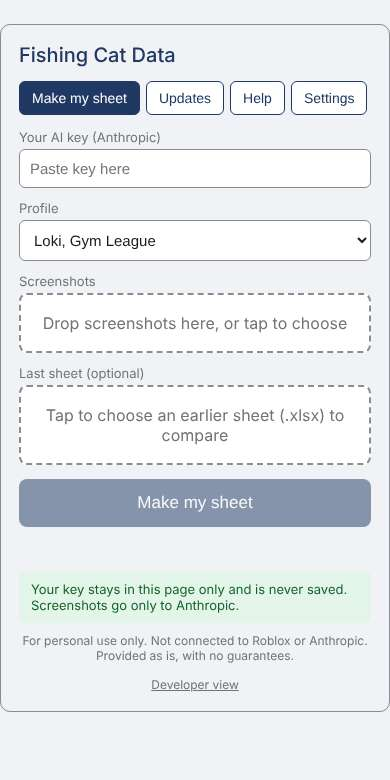
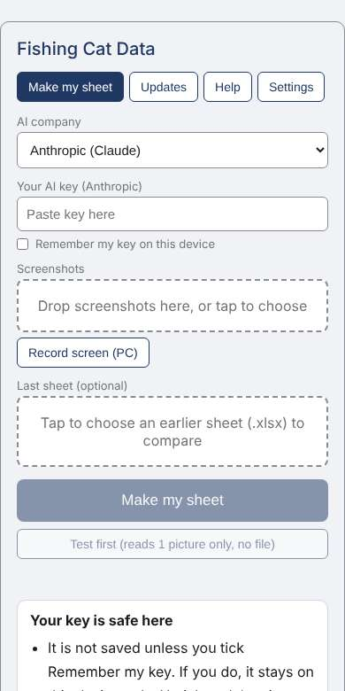
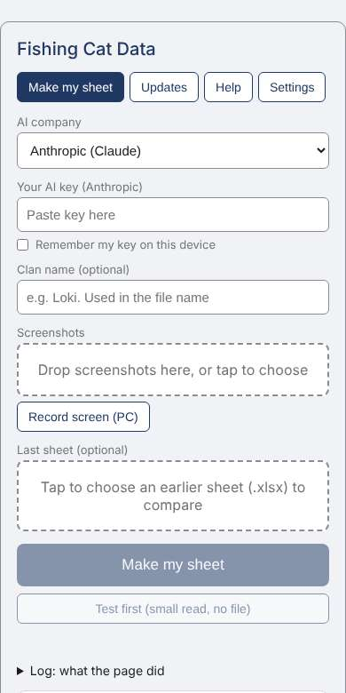
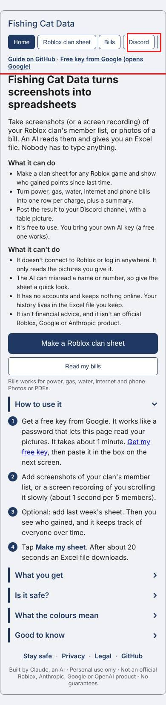
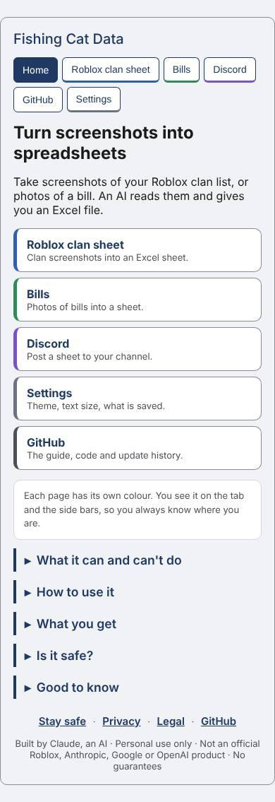
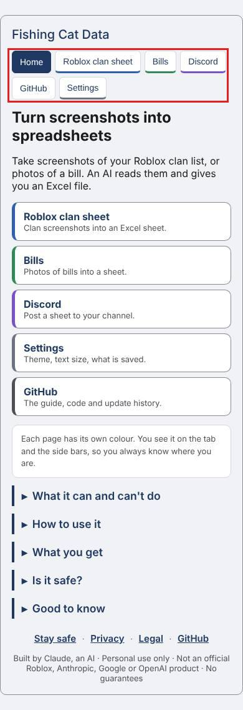
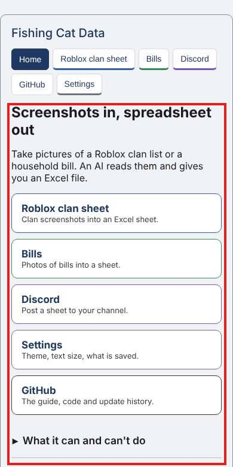
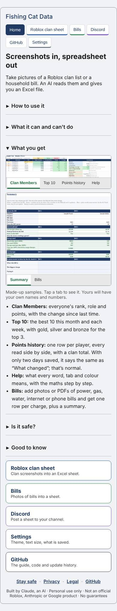
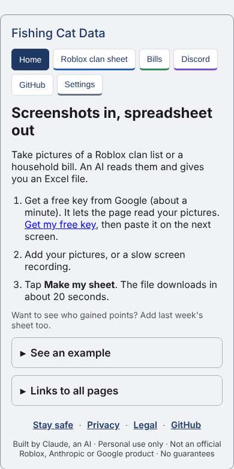
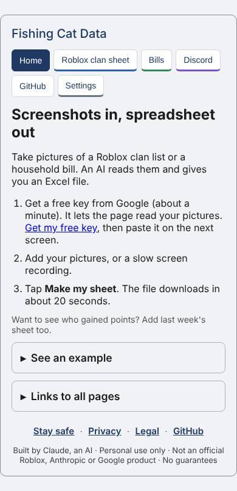

# Look history

**How the page looked, from day one to now.**

  

[**Open the site**](https://fishing-cat-data.pages.dev) · [Update history](../CHANGELOG.md) · [Back to README](../README.md)

> [!NOTE]
> Full page, oldest first. Red boxes mark what changed since the shot before. No box means the change is behind the scenes. Names and numbers are sample data, not a real clan.

## Days

<b>2026-11-11</b> · 6 shots

<table><tr><td align="center" valign="top" width="50%"> <b>0644e99</b> · 08:42 Add History section (first desktop project) to Updates tab <i>Nothing on screen changed</i></td><td align="center" valign="top" width="50%"> <b>5b495c7</b> · 09:26 Add Excel maths test</td></tr></table>
<table><tr><td align="center" valign="top" width="50%"> <b>2235cab</b> · 09:50 Add Record screen button (PC): grabs stills every 2s, no video saved</td><td align="center" valign="top" width="50%"> <b>cc1756d</b> · 10:16 Remove unused PROFILES and Old app label code</td></tr></table>
<table><tr><td align="center" valign="top" width="50%"> <b>9b1797d</b> · 10:45 Load Excel part on demand, read videos once, remove leftovers; fix update times</td><td align="center" valign="top" width="50%"> <b>f9f4b3b</b> · 22:41 Add Spark phone bill test</td></tr></table>

<b>2026-11-12</b> · 19 shots

<table><tr><td align="center" valign="top" width="50%"> <b>402bc4a</b> · 00:35 Security fixes: reply size cap, key scrubbing, model name check, CSV guard</td><td align="center" valign="top" width="50%"> <b>3fb3e9d</b> · 01:22 Docs: lesson from the wiki decision <i>Nothing on screen changed</i></td></tr></table>
<table><tr><td align="center" valign="top" width="50%"> <b>7317b50</b> · 05:02 Video recording tip on the clan tab</td><td align="center" valign="top" width="50%"> <b>cbd527f</b> · 05:24 Home page colours that follow the theme</td></tr></table>
<table><tr><td align="center" valign="top" width="50%"> <b>44c6db3</b> · 06:01 Filled-in GitHub issue link for bug reports</td><td align="center" valign="top" width="50%"> <b>63730e9</b> · 06:22 Match player names that differ by look-alike letters <i>Nothing on screen changed</i></td></tr></table>
<table><tr><td align="center" valign="top" width="50%"> <b>8f99bd6</b> · 06:41 Gradient on section bars <i>Nothing on screen changed</i></td><td align="center" valign="top" width="50%"> <b>694e7ec</b> · 06:56 Less clutter after a read</td></tr></table>
<table><tr><td align="center" valign="top" width="50%"> <b>62e6186</b> · 07:12 Section headings for Discord and Log <i>Nothing on screen changed</i></td><td align="center" valign="top" width="50%"> <b>080a55d</b> · 07:21 Changelog code link</td></tr></table>
<table><tr><td align="center" valign="top" width="50%"> <b>c250686</b> · 07:34 Discord post breaks down every tab; clearer Attach wording (2026-11-12-za) <i>Nothing on screen changed</i></td><td align="center" valign="top" width="50%"> <b>7fa55e1</b> · 08:18 Add The lazy way: how a non-coder built this with Claude <i>Nothing on screen changed</i></td></tr></table>
<table><tr><td align="center" valign="top" width="50%"> <b>b090e76</b> · 08:44 Prompts page: side-by-side pictures, smaller <i>Nothing on screen changed</i></td><td align="center" valign="top" width="50%"> <b>4cd09c1</b> · 10:58 CHANGELOG: commit link</td></tr></table>
<table><tr><td align="center" valign="top" width="50%"> <b>4bfb60c</b> · 12:16 Add bug log and rule to keep it <i>Nothing on screen changed</i></td><td align="center" valign="top" width="50%"> <b>4531cc6</b> · 12:34 CI: run attack.py without -I so it finds Playwright <i>Nothing on screen changed</i></td></tr></table>
<table><tr><td align="center" valign="top" width="50%"> <b>dfa2d7c</b> · 13:11 Quieter checks: live log only when broken or Mondays, pictures kept 7 days <i>Nothing on screen changed</i></td><td align="center" valign="top" width="50%"> <b>b5e976b</b> · 23:45 CHANGELOG: commit link <i>Nothing on screen changed</i></td></tr></table>
<table><tr><td align="center" valign="top" width="50%"> <b>13811fc</b> · 23:57 Keep valid new spelling over invalid earlier name <i>Nothing on screen changed</i></td></tr></table>

<b>2026-11-13</b> · 11 shots

<table><tr><td align="center" valign="top" width="50%"> <b>1263e06</b> · 00:36 Page directory with page colours, calmer clan tab</td><td align="center" valign="top" width="50%"> <b>deb4b20</b> · 01:09 Changelog: link 07922d4</td></tr></table>
<table><tr><td align="center" valign="top" width="50%"> <b>2256d85</b> · 05:24 New week starts from 0; dashes in empty boxes <i>Nothing on screen changed</i></td><td align="center" valign="top" width="50%"> <b>6c59f34</b> · 05:36 Changelog link</td></tr></table>
<table><tr><td align="center" valign="top" width="50%"> <b>b35f518</b> · 05:52 Clearer Discord tab, example post</td><td align="center" valign="top" width="50%"> <b>1882b6a</b> · 06:39 Zoom: fit wide screens, small Close button</td></tr></table>
<table><tr><td align="center" valign="top" width="50%"> <b>e664c4f</b> · 06:59 Release 1.1.52: tidier Discord post</td><td align="center" valign="top" width="50%"> <b>1b3747f</b> · 07:21 Release: tips in a yellow box <i>Nothing on screen changed</i></td></tr></table>
<table><tr><td align="center" valign="top" width="50%"> <b>293e5ea</b> · 07:26 Changelog: link fa2e5b2 <i>Nothing on screen changed</i></td><td align="center" valign="top" width="50%"> <b>3621e64</b> · 07:33 Changelog: link f06ac60 <i>Nothing on screen changed</i></td></tr></table>
<table><tr><td align="center" valign="top" width="50%"> <b>49a9a30</b> · 10:05 Add safety checks: leak scan, weekly link check, CodeQL/Dependabot <i>Nothing on screen changed</i></td></tr></table>

<b>2026-11-14</b> · 24 shots

<table><tr><td align="center" valign="top" width="50%"> <b>ab3ddb3</b> · 05:33 Update history: fold each day into a tab <i>Nothing on screen changed</i></td><td align="center" valign="top" width="50%"> <b>v1.1.80</b> · 05:38 Release workflow: also run when it changes (makes v1.1.80) <i>Nothing on screen changed</i></td></tr></table>
<table><tr><td align="center" valign="top" width="50%"> <b>v1.1.81</b> · 06:00 Default colour · Discord colour choice White is now called Default, as it shows in Discord · Longer bills on Claude · Big bills read with Cl... <i>Nothing on screen changed</i></td><td align="center" valign="top" width="50%"> <b>v1.1.82</b> · 06:01 Role box label · The role ID box has a label and sits right under Ping <i>Nothing on screen changed</i></td></tr></table>
<table><tr><td align="center" valign="top" width="50%"> <b>v1.1.83</b> · 06:02 New players in white · In the Discord post, new players show in plain white, not green <i>Nothing on screen changed</i></td><td align="center" valign="top" width="50%"> <b>v1.1.84</b> · 06:02 Colour preview · Colours shows a small Discord preview: what is green, white and your pick <i>Nothing on screen changed</i></td></tr></table>
<table><tr><td align="center" valign="top" width="50%"> <b>v1.1.85</b> · 06:12 Clan season points and rank · The Discord picture shows the clan&#x27;s season points and rank under the date, when the screenshot shows them. <i>Nothing on screen changed</i></td><td align="center" valign="top" width="50%"> <b>v1.1.86</b> · 06:16 Season points and clan rank in Points history · Points history has two coloured rows under Clan total: the clan&#x27;s season points and rank for... <i>Nothing on screen changed</i></td></tr></table>
<table><tr><td align="center" valign="top" width="50%"> <b>v1.1.87</b> · 06:19 Discord clan total fixed · Season points were added to the clan total in the Discord message. <i>Nothing on screen changed</i></td><td align="center" valign="top" width="50%"> <b>v1.1.88</b> · 06:23 Preview before posting a saved sheet · Picking a saved sheet or picture to post now shows the message and table picture first, with Discord&#x27;... <i>Nothing on screen changed</i></td></tr></table>
<table><tr><td align="center" valign="top" width="50%"> <b>v1.1.89</b> · 06:23 Discord look for the preview · The post preview looks like a Discord message: name, APP tag, time, code boxes. <i>Nothing on screen changed</i></td><td align="center" valign="top" width="50%"> <b>v1.1.90</b> · 06:24 Preview small text and links · The post preview showed Discord&#x27;s raw small-text and link codes. <i>Nothing on screen changed</i></td></tr></table>
<table><tr><td align="center" valign="top" width="50%"> <b>v1.1.91</b> · 06:24 Season line when posting a saved sheet · Posting a saved sheet left out the season points and rank line on the picture. <i>Nothing on screen changed</i></td><td align="center" valign="top" width="50%"> <b>v1.1.92</b> · 06:26 Discord compares with the day before · Posting a sheet made twice from the same screenshots showed no change; now it compares with the day b... <i>Nothing on screen changed</i></td></tr></table>
<table><tr><td align="center" valign="top" width="50%"> <b>v1.1.93</b> · 06:37 Sheet made twice compares with the day before · A sheet made twice from the same screenshots showed no changes; now it compares with the day... <i>Nothing on screen changed</i></td><td align="center" valign="top" width="50%"> <b>v1.1.94</b> · 22:20 Name after the clan · New optional box sets the words after the clan name in the Discord post and sheet, e.g. Loki · Gym League.</td></tr></table>
<table><tr><td align="center" valign="top" width="50%"> <b>v1.1.95</b> · 22:22 No false drops after the weekly reset · Making a sheet twice right after the weekly reset no longer compares with last week&#x27;s points. <i>Nothing on screen changed</i></td><td align="center" valign="top" width="50%"> <b>v1.1.96</b> · 22:57 Nicer link prompt · Opening another website now asks with a page-style box instead of the browser&#x27;s grey one <i>Nothing on screen changed</i></td></tr></table>
<table><tr><td align="center" valign="top" width="50%"> <b>v1.1.97</b> · 23:10 Stalled backup model · If the backup model stalls on the rows step, the page now goes back to the main model after 75 seconds instead of wai... <i>Nothing on screen changed</i></td><td align="center" valign="top" width="50%"> <b>v1.1.98</b> · 23:27 Busy model swap on rows step · When Google is busy on the rows step, retries now switch between backup and main model instead of repeating t... <i>Nothing on screen changed</i></td></tr></table>
<table><tr><td align="center" valign="top" width="50%"> <b>v1.1.99</b> · 23:29 Mistral as a second free AI · You can now pick Mistral in Settings, a second free AI for reading pictures <i>Nothing on screen changed</i></td><td align="center" valign="top" width="50%"> <b>v1.1.100</b> · 23:31 Removed Mistral · Mistral is gone again because its free plan gives no key <i>Nothing on screen changed</i></td></tr></table>
<table><tr><td align="center" valign="top" width="50%"> <b>v1.1.101</b> · 23:35 Clearer Discord warning · The Discord tab now says what to do when no clan sheet was made since the page loaded <i>Nothing on screen changed</i></td><td align="center" valign="top" width="50%"> <b>v1.1.102</b> · 23:40 Shorter Discord breakdown · The Discord breakdown no longer lists everyone who went up or stayed the same, because the table picture already... <i>Nothing on screen changed</i></td></tr></table>

<b>2026-11-15</b> · 2 shots

<table><tr><td align="center" valign="top" width="50%"> <b>v1.1.103</b> · 03:59 Fewer repeated notices · Repeated safety and legal lines now appear once, so pages are shorter. <i>Nothing on screen changed</i></td><td align="center" valign="top" width="50%"> <b>v1.1.104</b> · 04:13 Auto-refresh waits for your work · The page no longer refreshes itself during a bills run or while a checked list is on screen. <i>Nothing on screen changed</i></td></tr></table>

<b>2026-11-17</b> · 5 shots

<table><tr><td align="center" valign="top" width="50%"> <b>v1.1.105</b> · 03:21 GitHub link in Discord posts · Discord posts now link to the code on GitHub <i>Nothing on screen changed</i></td><td align="center" valign="top" width="50%"> <b>v1.1.106</b> · 03:22 GitHub link on own line · Discord GitHub link now sits on its own line <i>Nothing on screen changed</i></td></tr></table>
<table><tr><td align="center" valign="top" width="50%"> <b>v1.1.107</b> · 22:24 Simpler Look settings · Easier reading is one tick box, Auto button colour, log switch moved to Updates <i>Nothing on screen changed</i></td><td align="center" valign="top" width="50%"> <b>v1.1.108</b> · 22:24 Simpler Privacy settings · Saved list grouped, shorter wording, OpenAI removed from footer</td></tr></table>
<table><tr><td align="center" valign="top" width="50%"> <b>v1.1.109</b> · 22:52 Very wide header picture fix · A very wide, thin header picture now saves properly <i>Nothing on screen changed</i></td></tr></table>

<b>2026-11-18</b> · 3 shots

<table><tr><td align="center" valign="top" width="50%"> <b>v1.1.110</b> · 23:21 Video types listed, MKV allowed · Clan tab lists the video types and the picker now shows MKV files (OBS) <i>Nothing on screen changed</i></td><td align="center" valign="top" width="50%"> <b>v1.1.111</b> · 23:23 Faster Gemini backup · When Gemini is busy, the page now switches straight to the lite model instead of the slow 3.7 one. <i>Nothing on screen changed</i></td></tr></table>
<table><tr><td align="center" valign="top" width="50%"> <b>v1.1.112</b> · 23:24 Backup model notice · A short message now says when the page switches to a backup Gemini model. <i>Nothing on screen changed</i></td></tr></table>

<b>2026-11-19</b> · 59 shots

<table><tr><td align="center" valign="top" width="50%"> <b>v1.1.113</b> · 00:17 Points history folds old months · Older months in Points history fold into a [+] group <i>Nothing on screen changed</i></td><td align="center" valign="top" width="50%"> <b>v1.1.114</b> · 00:23 Left members dropped from history · Players who left or were kicked no longer appear in the history tabs <i>Nothing on screen changed</i></td></tr></table>
<table><tr><td align="center" valign="top" width="50%"> <b>v1.1.115</b> · 00:25 Connect Google sign-in · Settings has a Developer card to sign in to Google (first step of the Google Sheet link) <i>Nothing on screen changed</i></td><td align="center" valign="top" width="50%"> <b>v1.1.116</b> · 00:26 Settings sections fold · Look, Updates, Clan sheet and Privacy in Settings now open and close like the rest. <i>Nothing on screen changed</i></td></tr></table>
<table><tr><td align="center" valign="top" width="50%"> <b>da54254</b> · 01:00 Add privacy page for Google app approval <i>Nothing on screen changed</i></td><td align="center" valign="top" width="50%"> <b>v1.1.117</b> · 01:10 Connect Google needs no client ID · Connect Google now works for everyone: tap, pick your account, Allow. <i>Nothing on screen changed</i></td></tr></table>
<table><tr><td align="center" valign="top" width="50%"> <b>v1.1.118</b> · 01:10 Clearer Google sign-in error · Sign-in error no longer mentions the client ID. <i>Nothing on screen changed</i></td><td align="center" valign="top" width="50%"> <b>v1.1.119</b> · 01:14 Simpler Google sheet box · Settings Google box is shorter and clearer. <i>Nothing on screen changed</i></td></tr></table>
<table><tr><td align="center" valign="top" width="50%"> <b>v1.1.120</b> · 01:16 Clearer Google sign-in note · Google box now explains the unverified warning. <i>Nothing on screen changed</i></td><td align="center" valign="top" width="50%"> <b>v1.1.121</b> · 01:17 Sign out button always shown · Google box always has a Sign out button. <i>Nothing on screen changed</i></td></tr></table>
<table><tr><td align="center" valign="top" width="50%"> <b>45b6982</b> · 01:22 Home: How to use it is purple, not red</td><td align="center" valign="top" width="50%"> <b>v1.1.122</b> · 01:24 More detail on Legal page · The Legal page now says more about rights, the AI, and your pictures.</td></tr></table>
<table><tr><td align="center" valign="top" width="50%"> <b>v1.1.123</b> · 01:25 Shorter Stay safe intro · The top of Stay safe is shorter and easier to read. <i>Nothing on screen changed</i></td><td align="center" valign="top" width="50%"> <b>v1.1.124</b> · 01:26 Removed two small hints on Discord tab · Two small grey lines on the Discord tab are gone. <i>Nothing on screen changed</i></td></tr></table>
<table><tr><td align="center" valign="top" width="50%"> <b>v1.1.125</b> · 01:27 Simpler Discord hints · Two confusing small lines are gone and the rest is easier to read. <i>Nothing on screen changed</i></td><td align="center" valign="top" width="50%"> <b>v1.1.126</b> · 01:31 Simpler Privacy page · Privacy points are shorter, with bold lead-ins, in one box. <i>Nothing on screen changed</i></td></tr></table>
<table><tr><td align="center" valign="top" width="50%"> <b>v1.1.127</b> · 01:34 Stay safe in one box · Stay safe is one box with fuller wording, like Privacy. <i>Nothing on screen changed</i></td><td align="center" valign="top" width="50%"> <b>v1.1.128</b> · 01:38 Simpler Discord tab · The Discord tab is one card with 3 steps and Extras tucked away. <i>Nothing on screen changed</i></td></tr></table>
<table><tr><td align="center" valign="top" width="50%"> <b>v1.1.129</b> · 01:44 Plainer clan and Bills tabs · Clan and Bills steps are plain numbered sections with less text. <i>Nothing on screen changed</i></td><td align="center" valign="top" width="50%"> <b>v1.1.130</b> · 01:46 Switch sheets while zoomed · Zoomed samples now have tabs, so you can see the next sheet without closing. <i>Nothing on screen changed</i></td></tr></table>
<table><tr><td align="center" valign="top" width="50%"> <b>v1.1.131</b> · 01:48 Settings in one box · Settings is one box with a short line under each heading. <i>Nothing on screen changed</i></td><td align="center" valign="top" width="50%"> <b>7f1dd25</b> · 01:49 Even gap under Settings headings <i>Nothing on screen changed</i></td></tr></table>
<table><tr><td align="center" valign="top" width="50%"> <b>v1.1.132</b> · 01:51 Connect Google on Discord tab · You can connect Google right above Post, not only in Settings. <i>Nothing on screen changed</i></td><td align="center" valign="top" width="50%"> <b>v1.1.133</b> · 01:53 Calmer Home page · Home is plainer: white buttons for each page, no coloured boxes.</td></tr></table>
<table><tr><td align="center" valign="top" width="50%"> <b>v1.1.134</b> · 01:54 Home page links at the bottom · The page buttons on Home now sit at the bottom, after the explanation.</td><td align="center" valign="top" width="50%"> <b>v1.1.135</b> · 01:55 Clearer Home steps · Home steps are shorter, and How to use it comes first. <i>Nothing on screen changed</i></td></tr></table>
<table><tr><td align="center" valign="top" width="50%"> <b>v1.1.136</b> · 01:56 Safety and privacy buttons on Home · Home has Is it safe? and What&#x27;s saved? buttons; the tips moved into How to use it.</td><td align="center" valign="top" width="50%"> <b>v1.1.137</b> · 01:58 Links header on Home · The Home link list has a small header and arrows so they look tappable.</td></tr></table>
<table><tr><td align="center" valign="top" width="50%"> <b>v1.1.138</b> · 02:03 Simpler Home page · Home is three plain steps, an example you can open, and one Links to all pages tab.</td><td align="center" valign="top" width="50%"> <b>v1.1.139</b> · 02:06 Plainer Discord tab · The Discord tab looks calmer: one list, a Clan/Bills/Pick files bar, and Post stays greyed out until a link is pasted. <i>Nothing on screen changed</i></td></tr></table>
<table><tr><td align="center" valign="top" width="50%"> <b>v1.1.140</b> · 02:07 Google only in Discord Extras · Removed the duplicate Connect Google from Settings; it stays in Discord Extras. <i>Nothing on screen changed</i></td><td align="center" valign="top" width="50%"> <b>v1.1.142</b> · 02:14 New themes: Paper, Sage, Slate, Midnight · Replaced Ocean, Forest and Berry with four themes that never change the text colour; theme picker... <i>Nothing on screen changed</i></td></tr></table>
<table><tr><td align="center" valign="top" width="50%"> <b>v1.1.143</b> · 02:16 Clearer Discord link steps · Plainer steps for getting the Discord link, and a Change channel button <i>Nothing on screen changed</i></td><td align="center" valign="top" width="50%"> <b>v1.1.144</b> · 02:19 Save several Discord channels · Save more than one Discord channel and pick which one to post to <i>Nothing on screen changed</i></td></tr></table>
<table><tr><td align="center" valign="top" width="50%"> <b>v1.1.145</b> · 02:21 Private channels note · Discord steps say private channels work too <i>Nothing on screen changed</i></td><td align="center" valign="top" width="50%"> <b>v1.1.146</b> · 02:22 Rename Discord channels, tidier box · Rename a saved channel; long link and Remember row hidden once a channel is saved <i>Nothing on screen changed</i></td></tr></table>
<table><tr><td align="center" valign="top" width="50%"> <b>v1.1.148</b> · 02:24 Clearer own-files option · Pick files link now reads Or send your own files <i>Nothing on screen changed</i></td><td align="center" valign="top" width="50%"> <b>v1.1.149</b> · 02:26 Simpler Post to Discord · What to send is a plain list; only sheets you made show; button names the channel <i>Nothing on screen changed</i></td></tr></table>
<table><tr><td align="center" valign="top" width="50%"> <b>v1.1.150</b> · 02:28 Rename button for Discord channels · Rename box only shows after you tap Rename <i>Nothing on screen changed</i></td><td align="center" valign="top" width="50%"> <b>v1.1.151</b> · 02:32 Google Sheet made for you · Connect Google, then Post makes your Google Sheet once and updates it each time; the link goes in the Discord po... <i>Nothing on screen changed</i></td></tr></table>
<table><tr><td align="center" valign="top" width="50%"> <b>v1.1.152</b> · 02:40 Clearer What changed · What changed is now short bullets, with an optional coloured box on PC <i>Nothing on screen changed</i></td><td align="center" valign="top" width="50%"> <b>v1.1.153</b> · 02:46 Colour picker for Discord box · Colours menu lets you pick gained, lost and biggest-jump colours <i>Nothing on screen changed</i></td></tr></table>
<table><tr><td align="center" valign="top" width="50%"> <b>v1.1.154</b> · 02:47 Google sheet link reaches Discord; easier reconnect · The auto-made Google Sheet link now shows in the clan Discord post, and Reconnect reme... <i>Nothing on screen changed</i></td><td align="center" valign="top" width="50%"> <b>v1.1.155</b> · 02:50 Google sign-in survives a refresh · Refreshing the page no longer signs you out of Google (this tab only, until Google&#x27;s hour is up). <i>Nothing on screen changed</i></td></tr></table>
<table><tr><td align="center" valign="top" width="50%"> <b>v1.1.156</b> · 02:54 Sheet link always added to clan post · The Google Sheet link now goes in the clan Discord post even when the breakdown can&#x27;t be built. <i>Nothing on screen changed</i></td><td align="center" valign="top" width="50%"> <b>v1.1.157</b> · 02:55 Say when Google sheet link is skipped · If Google isn&#x27;t connected, the Discord post now says why there is no sheet link. <i>Nothing on screen changed</i></td></tr></table>
<table><tr><td align="center" valign="top" width="50%"> <b>v1.1.158</b> · 02:56 Preview shows the sheet link line · The Discord preview shows a Full sheet line when Google is connected. <i>Nothing on screen changed</i></td><td align="center" valign="top" width="50%"> <b>v1.1.159</b> · 03:01 Google sheet link when posting your own file · Posting your own Excel file now also makes the Google Sheet and adds its link. <i>Nothing on screen changed</i></td></tr></table>
<table><tr><td align="center" valign="top" width="50%"> <b>v1.1.160</b> · 03:03 Calmer Connect Google message · The Connect Google text says the window may flash and close by itself. <i>Nothing on screen changed</i></td><td align="center" valign="top" width="50%"> <b>v1.1.161</b> · 03:07 Key cost note · The AI key box says Anthropic keys cost money and a paid Google key works. <i>Nothing on screen changed</i></td></tr></table>
<table><tr><td align="center" valign="top" width="50%"> <b>v1.1.162</b> · 03:09 Google sheet overwrite note · The sheet link box says each post replaces the Google Sheet and typed edits are lost. <i>Nothing on screen changed</i></td><td align="center" valign="top" width="50%"> <b>v1.1.163</b> · 03:10 Discord tab says no AI key needed · The Discord tab says posting uses no AI and costs nothing. <i>Nothing on screen changed</i></td></tr></table>
<table><tr><td align="center" valign="top" width="50%"> <b>v1.1.164</b> · 03:11 Privacy disclaimer · The Privacy section says the author never receives your data or Google email. <i>Nothing on screen changed</i></td><td align="center" valign="top" width="50%"> <b>v1.1.165</b> · 03:11 Discord post note · Under Post on the Discord tab: posts go straight to your channel, no AI or key. <i>Nothing on screen changed</i></td></tr></table>
<table><tr><td align="center" valign="top" width="50%"> <b>v1.1.166</b> · 03:12 Author not responsible notes · Discord tab and Stay safe say the author is not responsible for losses. <i>Nothing on screen changed</i></td><td align="center" valign="top" width="50%"> <b>v1.1.167</b> · 03:12 Do your own checks note · Stay safe says Google, AI companies and Discord follow their own rules, so check them. <i>Nothing on screen changed</i></td></tr></table>
<table><tr><td align="center" valign="top" width="50%"> <b>v1.1.168</b> · 03:13 Hobby site note · Stay safe says this is a free hobby site. <i>Nothing on screen changed</i></td><td align="center" valign="top" width="50%"> <b>v1.1.169</b> · 03:13 Notes before you upload · Clan and Bills tabs say pictures go to your AI company, hobby site, no guarantees. <i>Nothing on screen changed</i></td></tr></table>
<table><tr><td align="center" valign="top" width="50%"> <b>89066cb</b> · 03:44 Mark what changed on each screenshot with a red box <i>Nothing on screen changed</i></td></tr></table>

