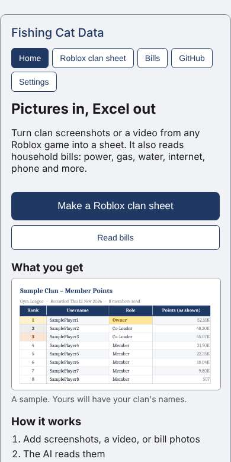
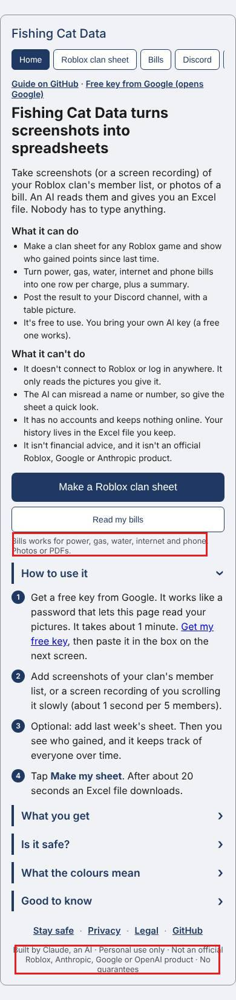
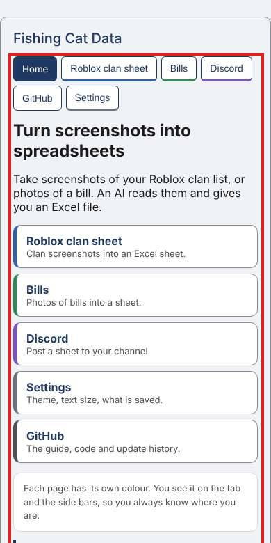
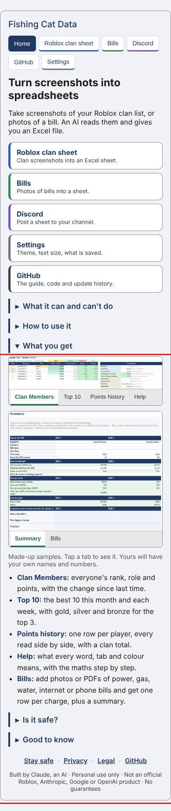
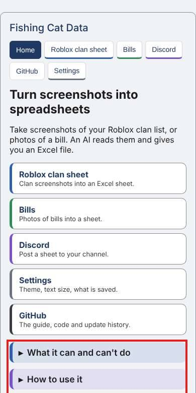
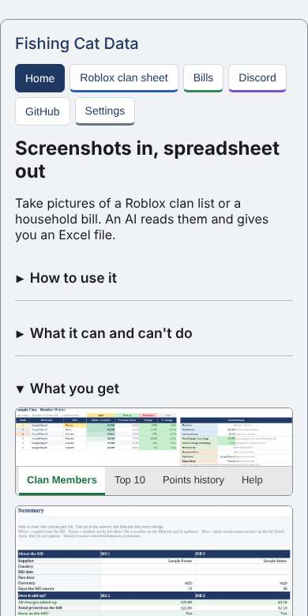

# Look history

**How the page looked, from day one to now.**

  

[**Open the site**](https://fishing-cat-data.pages.dev) · [Update history](../CHANGELOG.md) · [Back to README](../README.md)

> [!NOTE]
> Oldest first. Red boxes mark what changed on screen. Versions with no picture changed nothing you can see. Names and numbers are sample data, not a real clan.

## Days

<b>2026-11-11</b> · 6 versions

**0644e99** · 08:42 · Add History section (first desktop project) to Updates tab

**5b495c7** · 09:26

Add Excel maths test

**2235cab** · 09:50

Add Record screen button (PC): grabs stills every 2s, no video saved

**cc1756d** · 10:16

Remove unused PROFILES and Old app label code

**9b1797d** · 10:45

Load Excel part on demand, read videos once, remove leftovers; fix update times

**f9f4b3b** · 22:41

Add Spark phone bill test

<b>2026-11-12</b> · 19 versions

**402bc4a** · 00:35

Security fixes: reply size cap, key scrubbing, model name check, CSV guard

**3fb3e9d** · 01:22 · Docs: lesson from the wiki decision

**7317b50** · 05:02

Video recording tip on the clan tab

**cbd527f** · 05:24

Home page colours that follow the theme

**44c6db3** · 06:01

Filled-in GitHub issue link for bug reports

**63730e9** · 06:22 · Match player names that differ by look-alike letters

**8f99bd6** · 06:41 · Gradient on section bars

**694e7ec** · 06:56

Less clutter after a read

**62e6186** · 07:12 · Section headings for Discord and Log

**080a55d** · 07:21

Changelog code link

**c250686** · 07:34 · Discord post breaks down every tab; clearer Attach wording (2026-11-12-za)

**7fa55e1** · 08:18 · Add The lazy way: how a non-coder built this with Claude

**b090e76** · 08:44 · Prompts page: side-by-side pictures, smaller

**4cd09c1** · 10:58

CHANGELOG: commit link

**4bfb60c** · 12:16 · Add bug log and rule to keep it

**4531cc6** · 12:34 · CI: run attack.py without -I so it finds Playwright

**dfa2d7c** · 13:11 · Quieter checks: live log only when broken or Mondays, pictures kept 7 days

**b5e976b** · 23:45 · CHANGELOG: commit link

**13811fc** · 23:57 · Keep valid new spelling over invalid earlier name

<b>2026-11-13</b> · 11 versions

**1263e06** · 00:36

Page directory with page colours, calmer clan tab

**deb4b20** · 01:09

Changelog: link 07922d4

**2256d85** · 05:24 · New week starts from 0; dashes in empty boxes

**6c59f34** · 05:36

Changelog link

**b35f518** · 05:52

Clearer Discord tab, example post

**1882b6a** · 06:39

Zoom: fit wide screens, small Close button

**e664c4f** · 06:59

Release 1.1.52: tidier Discord post

**1b3747f** · 07:21 · Release: tips in a yellow box

**293e5ea** · 07:26 · Changelog: link fa2e5b2

**3621e64** · 07:33 · Changelog: link f06ac60

**49a9a30** · 10:05 · Add safety checks: leak scan, weekly link check, CodeQL/Dependabot

<b>2026-11-14</b> · 24 versions

**ab3ddb3** · 05:33 · Update history: fold each day into a tab

**v1.1.80** · 05:38 · Release workflow: also run when it changes (makes v1.1.80)

**v1.1.81** · 06:00 · Default colour · Discord colour choice White is now called Default, as it shows in Discord · Longer bills on Claude · Big bills read with Cl...

**v1.1.82** · 06:01 · Role box label · The role ID box has a label and sits right under Ping

**v1.1.83** · 06:02 · New players in white · In the Discord post, new players show in plain white, not green

**v1.1.84** · 06:02 · Colour preview · Colours shows a small Discord preview: what is green, white and your pick

**v1.1.85** · 06:12 · Clan season points and rank · The Discord picture shows the clan&#x27;s season points and rank under the date, when the screenshot shows them.

**v1.1.86** · 06:16 · Season points and clan rank in Points history · Points history has two coloured rows under Clan total: the clan&#x27;s season points and rank for...

**v1.1.87** · 06:19 · Discord clan total fixed · Season points were added to the clan total in the Discord message.

**v1.1.88** · 06:23 · Preview before posting a saved sheet · Picking a saved sheet or picture to post now shows the message and table picture first, with Discord&#x27;...

**v1.1.89** · 06:23 · Discord look for the preview · The post preview looks like a Discord message: name, APP tag, time, code boxes.

**v1.1.90** · 06:24 · Preview small text and links · The post preview showed Discord&#x27;s raw small-text and link codes.

**v1.1.91** · 06:24 · Season line when posting a saved sheet · Posting a saved sheet left out the season points and rank line on the picture.

**v1.1.92** · 06:26 · Discord compares with the day before · Posting a sheet made twice from the same screenshots showed no change; now it compares with the day b...

**v1.1.93** · 06:37 · Sheet made twice compares with the day before · A sheet made twice from the same screenshots showed no changes; now it compares with the day...

**v1.1.94** · 22:20

Name after the clan · New optional box sets the words after the clan name in the Discord post and sheet, e.g. Loki · Gym League.

**v1.1.95** · 22:22 · No false drops after the weekly reset · Making a sheet twice right after the weekly reset no longer compares with last week&#x27;s points.

**v1.1.96** · 22:57 · Nicer link prompt · Opening another website now asks with a page-style box instead of the browser&#x27;s grey one

**v1.1.97** · 23:10 · Stalled backup model · If the backup model stalls on the rows step, the page now goes back to the main model after 75 seconds instead of wai...

**v1.1.98** · 23:27 · Busy model swap on rows step · When Google is busy on the rows step, retries now switch between backup and main model instead of repeating t...

**v1.1.99** · 23:29 · Mistral as a second free AI · You can now pick Mistral in Settings, a second free AI for reading pictures

**v1.1.100** · 23:31 · Removed Mistral · Mistral is gone again because its free plan gives no key

**v1.1.101** · 23:35 · Clearer Discord warning · The Discord tab now says what to do when no clan sheet was made since the page loaded

**v1.1.102** · 23:40 · Shorter Discord breakdown · The Discord breakdown no longer lists everyone who went up or stayed the same, because the table picture already...

<b>2026-11-15</b> · 2 versions

**v1.1.103** · 03:59 · Fewer repeated notices · Repeated safety and legal lines now appear once, so pages are shorter.

**v1.1.104** · 04:13 · Auto-refresh waits for your work · The page no longer refreshes itself during a bills run or while a checked list is on screen.

<b>2026-11-17</b> · 5 versions

**v1.1.105** · 03:21 · GitHub link in Discord posts · Discord posts now link to the code on GitHub

**v1.1.106** · 03:22 · GitHub link on own line · Discord GitHub link now sits on its own line

**v1.1.107** · 22:24 · Simpler Look settings · Easier reading is one tick box, Auto button colour, log switch moved to Updates

**v1.1.108** · 22:24

Simpler Privacy settings · Saved list grouped, shorter wording, OpenAI removed from footer

**v1.1.109** · 22:52 · Very wide header picture fix · A very wide, thin header picture now saves properly

<b>2026-11-18</b> · 3 versions

**v1.1.110** · 23:21 · Video types listed, MKV allowed · Clan tab lists the video types and the picker now shows MKV files (OBS)

**v1.1.111** · 23:23 · Faster Gemini backup · When Gemini is busy, the page now switches straight to the lite model instead of the slow 3.7 one.

**v1.1.112** · 23:24 · Backup model notice · A short message now says when the page switches to a backup Gemini model.

<b>2026-11-19</b> · 59 versions

**v1.1.113** · 00:17 · Points history folds old months · Older months in Points history fold into a [+] group

**v1.1.114** · 00:23 · Left members dropped from history · Players who left or were kicked no longer appear in the history tabs

**v1.1.115** · 00:25 · Connect Google sign-in · Settings has a Developer card to sign in to Google (first step of the Google Sheet link)

**v1.1.116** · 00:26 · Settings sections fold · Look, Updates, Clan sheet and Privacy in Settings now open and close like the rest.

**da54254** · 01:00 · Add privacy page for Google app approval

**v1.1.117** · 01:10 · Connect Google needs no client ID · Connect Google now works for everyone: tap, pick your account, Allow.

**v1.1.118** · 01:10 · Clearer Google sign-in error · Sign-in error no longer mentions the client ID.

**v1.1.119** · 01:14 · Simpler Google sheet box · Settings Google box is shorter and clearer.

**v1.1.120** · 01:16 · Clearer Google sign-in note · Google box now explains the unverified warning.

**v1.1.121** · 01:17 · Sign out button always shown · Google box always has a Sign out button.

**45b6982** · 01:22

Home: How to use it is purple, not red

**v1.1.122** · 01:24

More detail on Legal page · The Legal page now says more about rights, the AI, and your pictures.

**v1.1.123** · 01:25 · Shorter Stay safe intro · The top of Stay safe is shorter and easier to read.

**v1.1.124** · 01:26 · Removed two small hints on Discord tab · Two small grey lines on the Discord tab are gone.

**v1.1.125** · 01:27 · Simpler Discord hints · Two confusing small lines are gone and the rest is easier to read.

**v1.1.126** · 01:31 · Simpler Privacy page · Privacy points are shorter, with bold lead-ins, in one box.

**v1.1.127** · 01:34 · Stay safe in one box · Stay safe is one box with fuller wording, like Privacy.

**v1.1.128** · 01:38 · Simpler Discord tab · The Discord tab is one card with 3 steps and Extras tucked away.

**v1.1.129** · 01:44 · Plainer clan and Bills tabs · Clan and Bills steps are plain numbered sections with less text.

**v1.1.130** · 01:46 · Switch sheets while zoomed · Zoomed samples now have tabs, so you can see the next sheet without closing.

**v1.1.131** · 01:48 · Settings in one box · Settings is one box with a short line under each heading.

**7f1dd25** · 01:49 · Even gap under Settings headings

**v1.1.132** · 01:51 · Connect Google on Discord tab · You can connect Google right above Post, not only in Settings.

**v1.1.133** · 01:53

Calmer Home page · Home is plainer: white buttons for each page, no coloured boxes.

**v1.1.134** · 01:54

Home page links at the bottom · The page buttons on Home now sit at the bottom, after the explanation.

**v1.1.135** · 01:55 · Clearer Home steps · Home steps are shorter, and How to use it comes first.

**v1.1.136** · 01:56

Safety and privacy buttons on Home · Home has Is it safe? and What&#x27;s saved? buttons; the tips moved into How to use it.

**v1.1.137** · 01:58

Links header on Home · The Home link list has a small header and arrows so they look tappable.

**v1.1.138** · 02:03

Simpler Home page · Home is three plain steps, an example you can open, and one Links to all pages tab.

**v1.1.139** · 02:06 · Plainer Discord tab · The Discord tab looks calmer: one list, a Clan/Bills/Pick files bar, and Post stays greyed out until a link is pasted.

**v1.1.140** · 02:07 · Google only in Discord Extras · Removed the duplicate Connect Google from Settings; it stays in Discord Extras.

**v1.1.142** · 02:14 · New themes: Paper, Sage, Slate, Midnight · Replaced Ocean, Forest and Berry with four themes that never change the text colour; theme picker...

**v1.1.143** · 02:16 · Clearer Discord link steps · Plainer steps for getting the Discord link, and a Change channel button

**v1.1.144** · 02:19 · Save several Discord channels · Save more than one Discord channel and pick which one to post to

**v1.1.145** · 02:21 · Private channels note · Discord steps say private channels work too

**v1.1.146** · 02:22 · Rename Discord channels, tidier box · Rename a saved channel; long link and Remember row hidden once a channel is saved

**v1.1.148** · 02:24 · Clearer own-files option · Pick files link now reads Or send your own files

**v1.1.149** · 02:26 · Simpler Post to Discord · What to send is a plain list; only sheets you made show; button names the channel

**v1.1.150** · 02:28 · Rename button for Discord channels · Rename box only shows after you tap Rename

**v1.1.151** · 02:32 · Google Sheet made for you · Connect Google, then Post makes your Google Sheet once and updates it each time; the link goes in the Discord po...

**v1.1.152** · 02:40 · Clearer What changed · What changed is now short bullets, with an optional coloured box on PC

**v1.1.153** · 02:46 · Colour picker for Discord box · Colours menu lets you pick gained, lost and biggest-jump colours

**v1.1.154** · 02:47 · Google sheet link reaches Discord; easier reconnect · The auto-made Google Sheet link now shows in the clan Discord post, and Reconnect reme...

**v1.1.155** · 02:50 · Google sign-in survives a refresh · Refreshing the page no longer signs you out of Google (this tab only, until Google&#x27;s hour is up).

**v1.1.156** · 02:54 · Sheet link always added to clan post · The Google Sheet link now goes in the clan Discord post even when the breakdown can&#x27;t be built.

**v1.1.157** · 02:55 · Say when Google sheet link is skipped · If Google isn&#x27;t connected, the Discord post now says why there is no sheet link.

**v1.1.158** · 02:56 · Preview shows the sheet link line · The Discord preview shows a Full sheet line when Google is connected.

**v1.1.159** · 03:01 · Google sheet link when posting your own file · Posting your own Excel file now also makes the Google Sheet and adds its link.

**v1.1.160** · 03:03 · Calmer Connect Google message · The Connect Google text says the window may flash and close by itself.

**v1.1.161** · 03:07 · Key cost note · The AI key box says Anthropic keys cost money and a paid Google key works.

**v1.1.162** · 03:09 · Google sheet overwrite note · The sheet link box says each post replaces the Google Sheet and typed edits are lost.

**v1.1.163** · 03:10 · Discord tab says no AI key needed · The Discord tab says posting uses no AI and costs nothing.

**v1.1.164** · 03:11 · Privacy disclaimer · The Privacy section says the author never receives your data or Google email.

**v1.1.165** · 03:11 · Discord post note · Under Post on the Discord tab: posts go straight to your channel, no AI or key.

**v1.1.166** · 03:12 · Author not responsible notes · Discord tab and Stay safe say the author is not responsible for losses.

**v1.1.167** · 03:12 · Do your own checks note · Stay safe says Google, AI companies and Discord follow their own rules, so check them.

**v1.1.168** · 03:13 · Hobby site note · Stay safe says this is a free hobby site.

**v1.1.169** · 03:13 · Notes before you upload · Clan and Bills tabs say pictures go to your AI company, hobby site, no guarantees.

**89066cb** · 03:44 · Mark what changed on each screenshot with a red box

