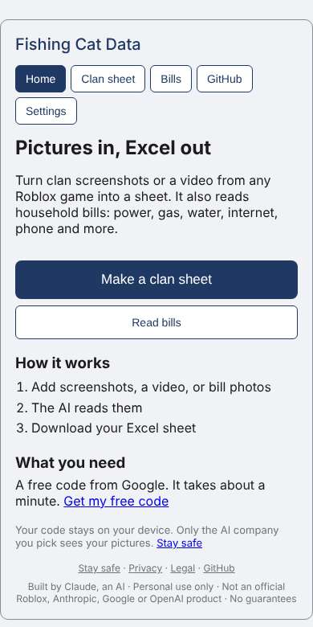
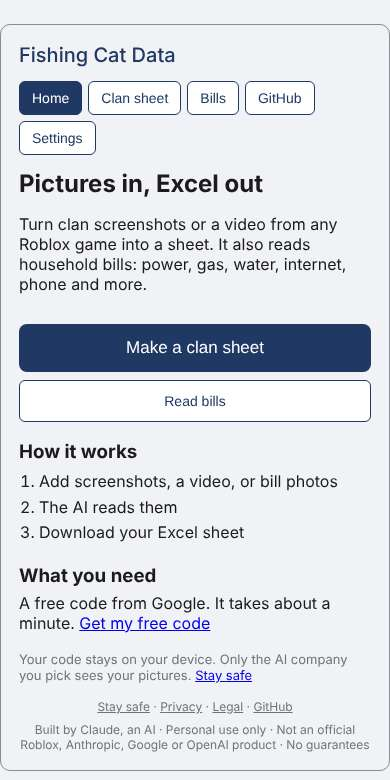
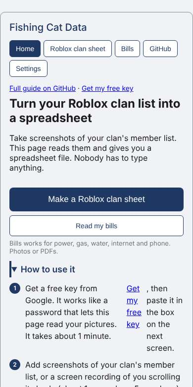
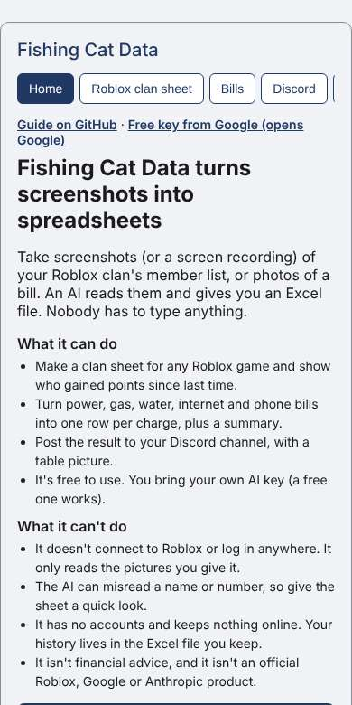
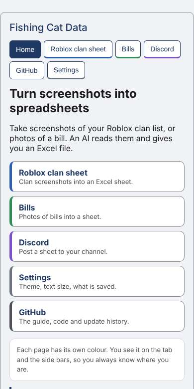
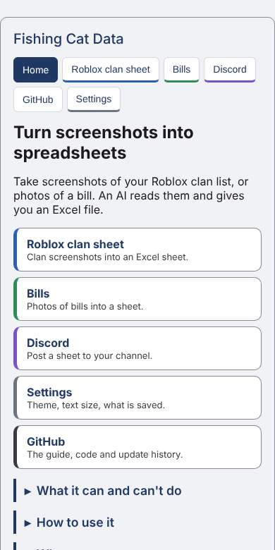
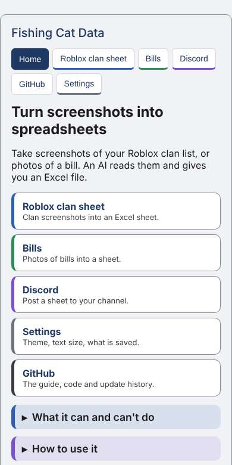
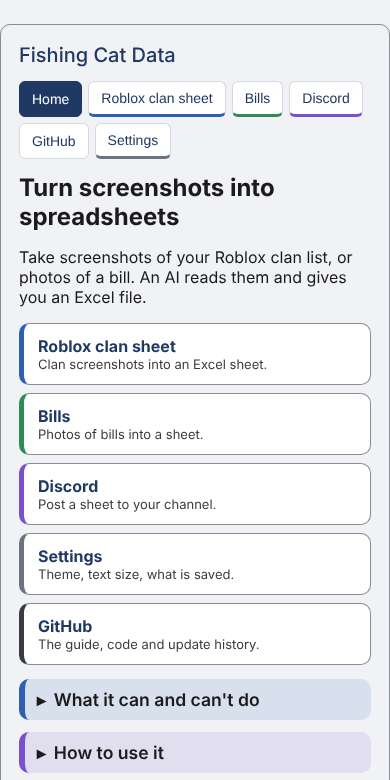
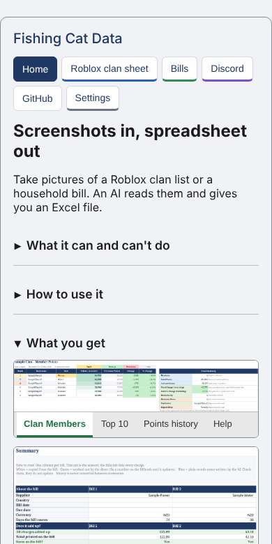

# Look history

How the page looked, from day one to now. Phone size, sample data. Oldest first.

## 2026-11-11

<table><tr><td align="center" valign="top"> <b>0644e99</b> · 08:42 Add History section (first desktop project) to Updates tab</td><td align="center" valign="top"> <b>5b495c7</b> · 09:26 Add Excel maths test</td><td align="center" valign="top"> <b>2235cab</b> · 09:50 Add Record screen button (PC): grabs stills every 2s, no vid</td></tr></table>
<table><tr><td align="center" valign="top"> <b>cc1756d</b> · 10:16 Remove unused PROFILES and Old app label code</td><td align="center" valign="top"> <b>9b1797d</b> · 10:45 Load Excel part on demand, read videos once, remove leftover</td><td align="center" valign="top"> <b>f9f4b3b</b> · 22:41 Add Spark phone bill test</td></tr></table>

## 2026-11-12

<table><tr><td align="center" valign="top"> <b>402bc4a</b> · 00:35 Security fixes: reply size cap, key scrubbing, model name ch</td><td align="center" valign="top"> <b>3fb3e9d</b> · 01:22 Docs: lesson from the wiki decision</td><td align="center" valign="top"> <b>7317b50</b> · 05:02 Video recording tip on the clan tab</td></tr></table>
<table><tr><td align="center" valign="top"> <b>cbd527f</b> · 05:24 Home page colours that follow the theme</td><td align="center" valign="top"> <b>44c6db3</b> · 06:01 Filled-in GitHub issue link for bug reports</td><td align="center" valign="top"> <b>63730e9</b> · 06:22 Match player names that differ by look-alike letters</td></tr></table>
<table><tr><td align="center" valign="top"> <b>8f99bd6</b> · 06:41 Gradient on section bars</td><td align="center" valign="top"> <b>694e7ec</b> · 06:56 Less clutter after a read</td><td align="center" valign="top"> <b>62e6186</b> · 07:12 Section headings for Discord and Log</td></tr></table>
<table><tr><td align="center" valign="top"> <b>080a55d</b> · 07:21 Changelog code link</td><td align="center" valign="top"> <b>c250686</b> · 07:34 Discord post breaks down every tab; clearer Attach wording (</td><td align="center" valign="top"> <b>7fa55e1</b> · 08:18 Add The lazy way: how a non-coder built this with Claude</td></tr></table>
<table><tr><td align="center" valign="top"> <b>b090e76</b> · 08:44 Prompts page: side-by-side pictures, smaller</td><td align="center" valign="top"> <b>4cd09c1</b> · 10:58 CHANGELOG: commit link</td><td align="center" valign="top"> <b>4bfb60c</b> · 12:16 Add bug log and rule to keep it</td></tr></table>
<table><tr><td align="center" valign="top"> <b>4531cc6</b> · 12:34 CI: run attack.py without -I so it finds Playwright</td><td align="center" valign="top"> <b>dfa2d7c</b> · 13:11 Quieter checks: live log only when broken or Mondays, pictur</td><td align="center" valign="top"> <b>b5e976b</b> · 23:45 CHANGELOG: commit link</td></tr></table>
<table><tr><td align="center" valign="top"> <b>13811fc</b> · 23:57 Keep valid new spelling over invalid earlier name</td></tr></table>

## 2026-11-13

<table><tr><td align="center" valign="top"> <b>1263e06</b> · 00:36 Page directory with page colours, calmer clan tab</td><td align="center" valign="top"> <b>deb4b20</b> · 01:09 Changelog: link 07922d4</td><td align="center" valign="top"> <b>2256d85</b> · 05:24 New week starts from 0; dashes in empty boxes</td></tr></table>
<table><tr><td align="center" valign="top"> <b>6c59f34</b> · 05:36 Changelog link</td><td align="center" valign="top"> <b>b35f518</b> · 05:52 Clearer Discord tab, example post</td><td align="center" valign="top"> <b>1882b6a</b> · 06:39 Zoom: fit wide screens, small Close button</td></tr></table>
<table><tr><td align="center" valign="top"> <b>e664c4f</b> · 06:59 Release 1.1.52: tidier Discord post</td><td align="center" valign="top"> <b>1b3747f</b> · 07:21 Release: tips in a yellow box</td><td align="center" valign="top"> <b>293e5ea</b> · 07:26 Changelog: link fa2e5b2</td></tr></table>
<table><tr><td align="center" valign="top"> <b>3621e64</b> · 07:33 Changelog: link f06ac60</td><td align="center" valign="top"> <b>49a9a30</b> · 10:05 Add safety checks: leak scan, weekly link check, CodeQL/Depe</td></tr></table>

## 2026-11-14

<table><tr><td align="center" valign="top"> <b>ab3ddb3</b> · 05:33 Update history: fold each day into a tab</td><td align="center" valign="top"> <b>v1.1.80</b> · 05:38 Release workflow: also run when it changes (makes v1.1.80)</td><td align="center" valign="top"> <b>v1.1.81</b> · 06:00 Discord colours: White renamed Default</td></tr></table>
<table><tr><td align="center" valign="top"> <b>v1.1.82</b> · 06:01 Discord: label role ID box, move it under Ping</td><td align="center" valign="top"> <b>v1.1.83</b> · 06:02 Discord: New list in plain white</td><td align="center" valign="top"> <b>v1.1.84</b> · 06:02 Discord colours: live preview of where colours go</td></tr></table>
<table><tr><td align="center" valign="top"> <b>v1.1.85</b> · 06:12 Clan season points + rank line on Discord picture</td><td align="center" valign="top"> <b>v1.1.86</b> · 06:16 Season points and clan rank rows in Points history</td><td align="center" valign="top"> <b>v1.1.87</b> · 06:19 Fix Discord clan total counting season points</td></tr></table>
<table><tr><td align="center" valign="top"> <b>v1.1.88</b> · 06:23 Preview saved-sheet Discord post with colours</td><td align="center" valign="top"> <b>v1.1.89</b> · 06:23 Discord-style preview header</td><td align="center" valign="top"> <b>v1.1.90</b> · 06:24 Preview: Discord small text and links</td></tr></table>
<table><tr><td align="center" valign="top"> <b>v1.1.91</b> · 06:24 Season line on saved-sheet Discord picture</td><td align="center" valign="top"> <b>v1.1.92</b> · 06:26 Discord post compares with the previous day when nothing cha</td><td align="center" valign="top"> <b>v1.1.93</b> · 06:37 Sheet made twice compares with the day before</td></tr></table>
<table><tr><td align="center" valign="top"> <b>v1.1.94</b> · 22:20 Optional name after the clan</td><td align="center" valign="top"> <b>v1.1.95</b> · 22:22 Same-run compare skips the day before when it was last week</td><td align="center" valign="top"> <b>v1.1.96</b> · 22:57 Own popup for outside links</td></tr></table>
<table><tr><td align="center" valign="top"> <b>v1.1.97</b> · 23:10 Rows step falls back to main model when backup stalls</td><td align="center" valign="top"> <b>v1.1.98</b> · 23:27 Rows step alternates models on busy errors</td><td align="center" valign="top"> <b>v1.1.99</b> · 23:29 Add Mistral as a second AI (untested)</td></tr></table>
<table><tr><td align="center" valign="top"> <b>v1.1.100</b> · 23:31 Remove Mistral</td><td align="center" valign="top"> <b>v1.1.101</b> · 23:35 Clearer no-sheet message on Discord tab</td><td align="center" valign="top"> <b>v1.1.102</b> · 23:40 Shorter Discord breakdown: counts line instead of long lists</td></tr></table>

## 2026-11-15

<table><tr><td align="center" valign="top"> <b>v1.1.103</b> · 03:59 Trim repeated notices</td><td align="center" valign="top"> <b>v1.1.104</b> · 04:13 Auto-refresh no longer reloads during a bills run or while a</td></tr></table>

## 2026-11-17

<table><tr><td align="center" valign="top"> <b>v1.1.105</b> · 03:21 Discord post: add GitHub link</td><td align="center" valign="top"> <b>v1.1.106</b> · 03:22 Discord post: GitHub link on its own line</td><td align="center" valign="top"> <b>v1.1.107</b> · 22:24 Simpler Look settings</td></tr></table>
<table><tr><td align="center" valign="top"> <b>v1.1.108</b> · 22:24 Simpler Privacy settings</td><td align="center" valign="top"> <b>v1.1.109</b> · 22:52 Header picture fix: very wide picture saved empty</td></tr></table>

## 2026-11-18

<table><tr><td align="center" valign="top"> <b>v1.1.110</b> · 23:21 Video types listed, MKV allowed</td><td align="center" valign="top"> <b>v1.1.111</b> · 23:23 Gemini backup goes straight to lite model</td><td align="center" valign="top"> <b>v1.1.112</b> · 23:24 Show notice when switching Gemini model</td></tr></table>

## 2026-11-19

<table><tr><td align="center" valign="top"> <b>v1.1.113</b> · 00:17 Points history: fold past months into a collapsed group</td><td align="center" valign="top"> <b>v1.1.114</b> · 00:23 History: drop members who left or were kicked</td><td align="center" valign="top"> <b>v1.1.115</b> · 00:25 Google sign-in (batch 1): Settings Developer card</td></tr></table>
<table><tr><td align="center" valign="top"> <b>v1.1.116</b> · 00:26 Settings sections fold open and shut</td><td align="center" valign="top"> <b>da54254</b> · 01:00 Add privacy page for Google app approval</td><td align="center" valign="top"> <b>v1.1.117</b> · 01:10 Build Google client ID into the page</td></tr></table>
<table><tr><td align="center" valign="top"> <b>v1.1.118</b> · 01:10 Reword Google sign-in error</td><td align="center" valign="top"> <b>v1.1.119</b> · 01:14 Simplify Google settings box</td><td align="center" valign="top"> <b>v1.1.120</b> · 01:16 Clearer Google sign-in note</td></tr></table>
<table><tr><td align="center" valign="top"> <b>v1.1.121</b> · 01:17 Always show Google Sign out button</td><td align="center" valign="top"> <b>45b6982</b> · 01:22 Home: How to use it is purple, not red</td><td align="center" valign="top"> <b>v1.1.122</b> · 01:24 More detail on Legal page</td></tr></table>
<table><tr><td align="center" valign="top"> <b>v1.1.123</b> · 01:25 Shorter Stay safe intro</td><td align="center" valign="top"> <b>v1.1.124</b> · 01:26 Remove two small hints on Discord tab</td><td align="center" valign="top"> <b>v1.1.125</b> · 01:27 Simpler Discord hints</td></tr></table>
<table><tr><td align="center" valign="top"> <b>v1.1.126</b> · 01:31 Simpler Privacy page</td><td align="center" valign="top"> <b>v1.1.127</b> · 01:34 Stay safe in one box with fuller wording</td><td align="center" valign="top"> <b>v1.1.128</b> · 01:38 Simpler Discord tab</td></tr></table>
<table><tr><td align="center" valign="top"> <b>v1.1.129</b> · 01:44 Plainer clan and Bills tabs</td><td align="center" valign="top"> <b>v1.1.130</b> · 01:46 Switch sheets while zoomed</td><td align="center" valign="top"> <b>v1.1.131</b> · 01:48 Settings in one box</td></tr></table>
<table><tr><td align="center" valign="top"> <b>7f1dd25</b> · 01:49 Even gap under Settings headings</td><td align="center" valign="top"> <b>v1.1.132</b> · 01:51 Connect Google on Discord tab</td><td align="center" valign="top"> <b>v1.1.133</b> · 01:53 Calmer Home page</td></tr></table>
<table><tr><td align="center" valign="top"> <b>v1.1.134</b> · 01:54 Home page links at the bottom</td><td align="center" valign="top"> <b>v1.1.135</b> · 01:55 Clearer Home steps</td><td align="center" valign="top"> <b>v1.1.136</b> · 01:56 Safety and privacy buttons on Home</td></tr></table>
<table><tr><td align="center" valign="top"> <b>v1.1.137</b> · 01:58 Links header on Home</td><td align="center" valign="top"> <b>v1.1.138</b> · 02:03 Simpler Home page</td><td align="center" valign="top"> <b>v1.1.139</b> · 02:06 Plainer Discord tab (v1.1.139)</td></tr></table>
<table><tr><td align="center" valign="top"> <b>v1.1.140</b> · 02:07 Remove duplicate Google block from Settings (v1.1.140)</td><td align="center" valign="top"> <b>v1.1.142</b> · 02:14 Merge main; themes now v1.1.142</td><td align="center" valign="top"> <b>v1.1.143</b> · 02:16 Clearer Discord link steps, Change channel button</td></tr></table>
<table><tr><td align="center" valign="top"> <b>v1.1.144</b> · 02:19 Save several Discord channels</td><td align="center" valign="top"> <b>v1.1.145</b> · 02:21 Discord steps: private channels work too</td><td align="center" valign="top"> <b>v1.1.146</b> · 02:22 Rename Discord channels; hide long link for saved channels</td></tr></table>
<table><tr><td align="center" valign="top"> <b>v1.1.148</b> · 02:24 Clearer own-files option and grey hint</td><td align="center" valign="top"> <b>v1.1.149</b> · 02:26 Simpler Post to Discord: what-to-send list, channel-named bu</td><td align="center" valign="top"> <b>v1.1.150</b> · 02:28 Discord channel: Rename button instead of a second box</td></tr></table>
<table><tr><td align="center" valign="top"> <b>v1.1.151</b> · 02:32 Google Sheet made for you: Post uploads the Excel file as a </td><td align="center" valign="top"> <b>v1.1.152</b> · 02:40 Clearer What changed: bullets, optional coloured box on PC</td><td align="center" valign="top"> <b>v1.1.153</b> · 02:46 Colour picker for the Discord What changed box</td></tr></table>
<table><tr><td align="center" valign="top"> <b>v1.1.154</b> · 02:47 Fix: Google sheet link in clan Discord post; remember Google</td><td align="center" valign="top"> <b>v1.1.155</b> · 02:50 Fix: Google sign-in survives page refresh</td><td align="center" valign="top"> <b>v1.1.156</b> · 02:54 Fix: add sheet link right before clan post; break test for G</td></tr></table>
<table><tr><td align="center" valign="top"> <b>v1.1.157</b> · 02:55 Say why no Google sheet link when not connected</td><td align="center" valign="top"> <b>v1.1.158</b> · 02:56 Preview shows Full sheet line when Google connected</td><td align="center" valign="top"> <b>v1.1.159</b> · 03:01 Make Google sheet link when posting your own Excel file</td></tr></table>
<table><tr><td align="center" valign="top"> <b>v1.1.160</b> · 03:03 Calmer Connect Google message</td><td align="center" valign="top"> <b>v1.1.161</b> · 03:07 Note on key costs under AI company</td><td align="center" valign="top"> <b>v1.1.162</b> · 03:09 Warn that each post replaces the Google Sheet</td></tr></table>
<table><tr><td align="center" valign="top"> <b>v1.1.163</b> · 03:10 Discord tab: posting uses no AI key</td><td align="center" valign="top"> <b>v1.1.164</b> · 03:11 Add no-data-collected disclaimer</td><td align="center" valign="top"> <b>v1.1.165</b> · 03:11 Discord tab: note under Post</td></tr></table>
<table><tr><td align="center" valign="top"> <b>v1.1.166</b> · 03:12 Stronger author-not-responsible wording</td><td align="center" valign="top"> <b>v1.1.167</b> · 03:12 Add do-your-own-checks note for third parties</td><td align="center" valign="top"> <b>v1.1.168</b> · 03:13 Say it is a hobby site</td></tr></table>
<table><tr><td align="center" valign="top"> <b>v1.1.169</b> · 03:13 Notice above Make my sheet on Clan and Bills</td><td align="center" valign="top"> <b>20a440e</b> · 03:17 STATUS: tidy-up list for later</td></tr></table>
