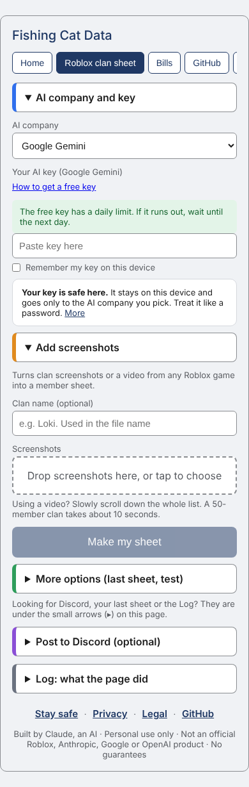
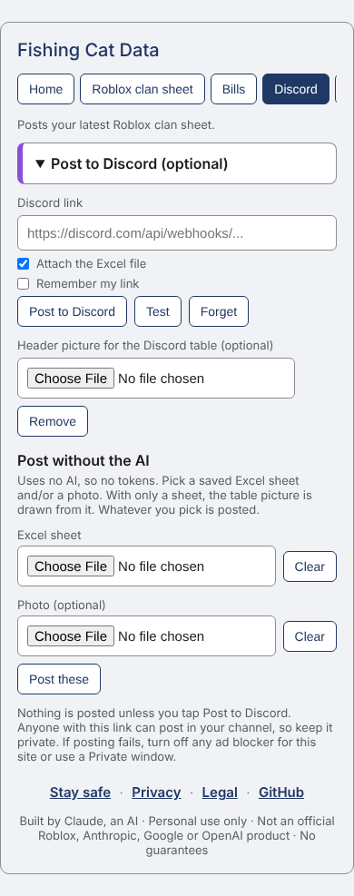
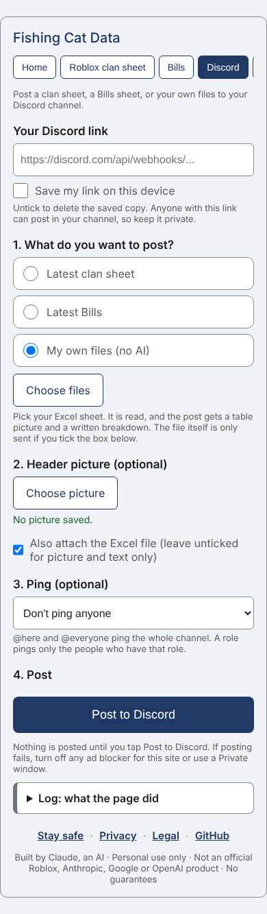
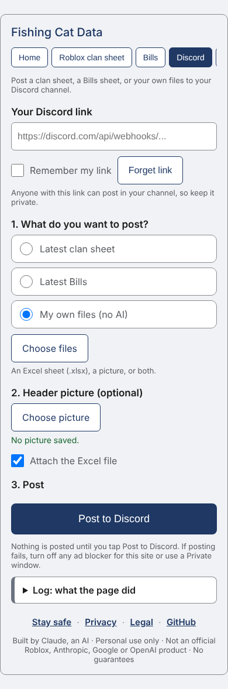
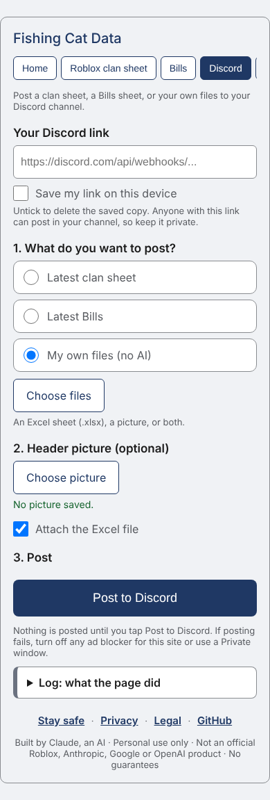

# What Ginger actually typed

Ginger doesn't code. Claude wrote every line of this app from messages like these, mostly typed on a phone. Spelling fixed, nothing else touched.

## First we built an app. It failed.

Ginger got bored of it: too many windows, buttons and owner codes, and every fix needed another install. So on 11 Nov it started over as a web page.

> "Can we redo the owner shit and make it simpler, I keep losing it"

Claude swapped the key file for a password.

> "Fuck it this is too annoying, lets do how it was before, no owner shit and password"

All owner codes gone.

> "These are UGLY, update again please too!!!"

> "This mega ugly."

> "Bit much on the eyes"

Three redesigns in one night.

> "Can we confirm that this works without wifi??"

It didn't. Now it does.

> "Refresh and clear button don't work lol"

They didn't.

> "Can we make the speed test not flash you"

It had been flashing at them.

> "Profile thing is too wonky and too stupid to make simple"

> "just remove the whole profile thingy lol"

> "Yeah just all of it and start over"

Profiles, tabs and buttons all deleted.

> "how much of this is bloat lol"

About half of it.

> "Dude look and compare. Look how weird the spacings are between the two!"

They were.

> "No I meant like clickable tabs, Game tab, bill tab"

Claude had given them a drop-down.

> "can we remove that nifty popup thingy"

Not our code. The host added it. We moved hosts.

> "This reads so boring and like a language model"

Claude rewrote it in plain words.

## Then the website

> "This spacing and the discord thingy?"

The clan tab, with uneven gaps and the Discord box in the middle:

> "I don't see a point in this, it should be upload photo/video and it fills it in"

Claude had built a form. It deleted the form.

> "fixy dumbo"

Claude asked permission to fix something. Two words fixed that.

> "Uhhh this seems hard to use" / "So many buttons"

The Discord box was cut to four steps.

What they were looking at, first Discord tab:

What it is now:

> "Isn't this weird lol"

A Remember button and a Forget button, side by side. Now one tick box.

Before:

After:

> "looks like a bunch of shitty numbers"

Fair. The Discord post got headings, plain words and green and red lines.

> "Borning!"

The lazy guide got a story.

## How often it came up (at least)

- Make it simpler or delete it: 21
- Ugly, awful, boring, weird: 14
- Show me a mockup first: 13
- Hand off, new chat, chat too long: 12
- Save my tokens: 8
- Here's the repo access again: 7

Most repeats happened because every new chat started blank. `CLAUDE.md` and `STATUS.md` fixed that on 11 to 12 Nov.

## Their shorthand

- **lol**: not angry. "This is a bit silly, fix it."
- **Jeez**: you took too long. Just do it.
- **Patch please**: stop asking, build it.
- **thingy**: whatever that part is called.
- **bloat**: features nobody uses. Cut them.
- **No I meant...**: you got it wrong, here's what I pictured.
- **Cool**: approved, next thing.

## What worked

A screenshot plus one line. Saying the result you want. A mockup before building. And swearing was a clear signal to simplify, not to explain.
